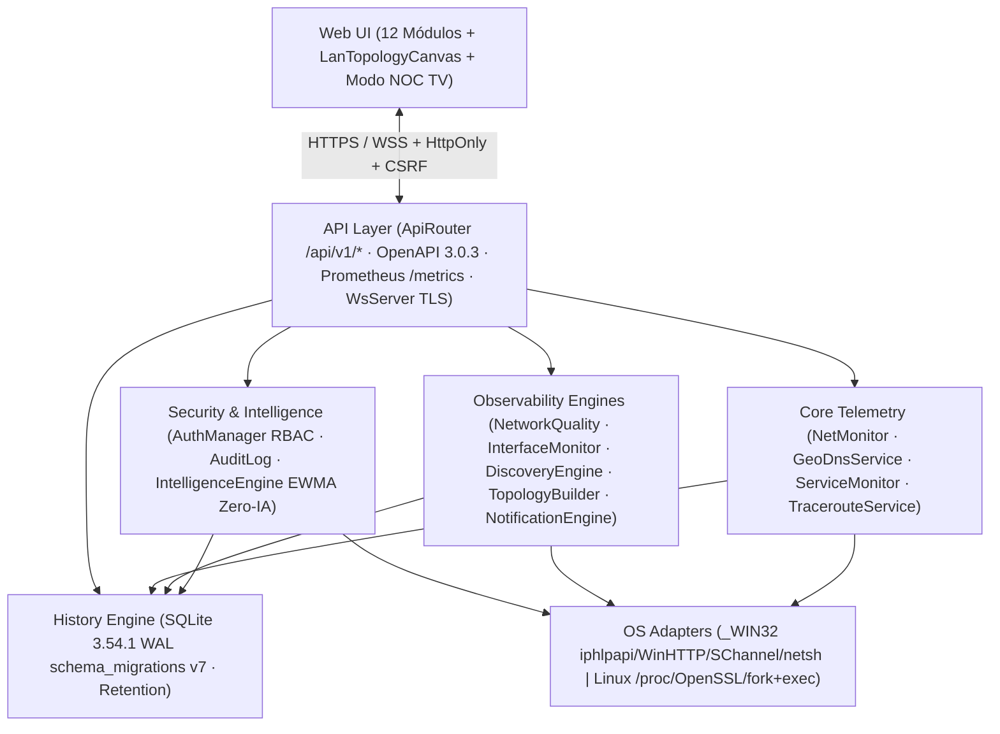

# NetPulse — Arquitetura da Plataforma

## 1. Visão Geral

O **NetPulse** é uma plataforma nativa de observabilidade, diagnóstico e segurança de redes construída sobre um motor **C++20 (`/O2`)** com servidor HTTP/HTTPS e WebSocket (RFC-6455) embutido e interface web modular em HTML5 Canvas2D (`static/`).

Todas as análises comportamentais e diagnósticos operam de forma **100% determinística** (regras, estatística descritiva, percentis e correlação de estado), sem inteligência artificial, LLMs ou dependência obrigatória de nuvem.

---

## 2. Diagrama de Arquitetura (Plataforma Modular NetPulse v2.0.0)

---

## 3. Estrutura de Módulos (NetPulse v2.0.0)

| Módulo / Diretório | Arquivos | Responsabilidade |
| :--- | :--- | :--- |
| **Core Utilities & Specs** | `src/core/json_lite.*`, `src/api/prometheus_openapi.*` | Parser RFC-8259 estrito, exportador Prometheus `/metrics` e especificação OpenAPI 3.0.3 (`/api/v1/openapi.json`). |
| **Models & Serializer** | `src/models.hpp`, `src/serializer.hpp`, `src/version.hpp` | Estruturas de telemetria e serialização JSON para snapshots em tempo real. |
| **Network Telemetry** | `src/net_monitor.*`, `src/network/interface_monitor.*` | Sockets TCP/UDP IPv4/IPv6, PID/executável, EStats/Process IO e inventário Multi-WAN RX/TX/gateways/DNS. |
| **GeoIP, rDNS & Trace** | `src/geo_dns.*`, `src/mmdb_reader.*`, `src/service_monitor.*`, `src/traceroute.*` | Leitor `.mmdb` offline, GeoIP/rDNS em lote, âncoras TCP, traceroute periódico com Route Diff FNV-1a e ASN. |
| **Quality Engine** | `src/quality/network_quality_engine.*` | Sondagem ICMP/TCP/DNS RFC-1035, percentis P50–P99, jitter, packet loss e diagnóstico determinístico. |
| **Discovery & Topology** | `src/discovery/discovery_engine.*`, `src/discovery/topology_builder.*` | ARP passivo, scan ativo `/24`, IEEE OUI offline, MAC LAA e grafo LAN com evidência por aresta. |
| **Intelligence Determinística** | `src/intelligence/intelligence_engine.*` | 9 detectores comportamentais, baselines EWMA, 6 regras customizáveis, índice de risco 0–100 e allow/blocklist (sem IA). |
| **Notifications Engine** | `src/notifications/notification_engine.*` | Fila assíncrona Webhook (HMAC-SHA256 RFC-2104), Discord e Telegram com cooldown e validação SSRF/HTTPS. |
| **Security Engine** | `src/security/auth_manager.*`, `audit_log.*`, `rate_limiter.*`, `tls_context.*` | Tokens RBAC (`Viewer`/`Operator`/`Administrator`), sessões, CSRF, TLS nativo, rate limit e auditoria operacional. |
| **API, Actions & History** | `src/api/api_router.*`, `src/ws_server.*`, `src/actions.*`, `src/storage/sqlite_db.*`, `src/history_store.*` | Rotas `/api/v1/*` + `/api/noc/overview`, firewall granular reversível e persistência SQLite WAL (`v7`). |
| **Frontend Modular** | `static/index.html`, `styles.css`, `app.js`, `map-canvas.js`, `lan-topo.js`, `noc-dashboard.js`, `topo.js` | Mapa planetário, Hub de 12 Módulos, Topologia LAN e Wallboard Modo NOC TV somente leitura. |

---

## 4. Fluxo de Segurança por Requisição

1. **TLS Handshake** (quando `--tls` ou acesso remoto sem proxy TLS): SChannel (Windows) ou OpenSSL (Linux).
2. **Rate Limiter por IP**: janela deslizante na camada de transporte + bloqueio estrito em `/api/auth/login`.
3. **Host & Origin Validation**: proteção contra DNS Rebinding (`Host`) e CSRF/CSWSH (`Origin`).
4. **Autenticação & RBAC**: `Authorization: Bearer <token>` ou cookie `np_session` (`HttpOnly; SameSite=Strict`) + `X-CSRF-Token` obrigatório em mutações.
5. **Confirmação Explícita & Auditoria**: operações destrutivas exigem `"confirm": true` e gravam registro imutável em `security_audit.tsv`.
