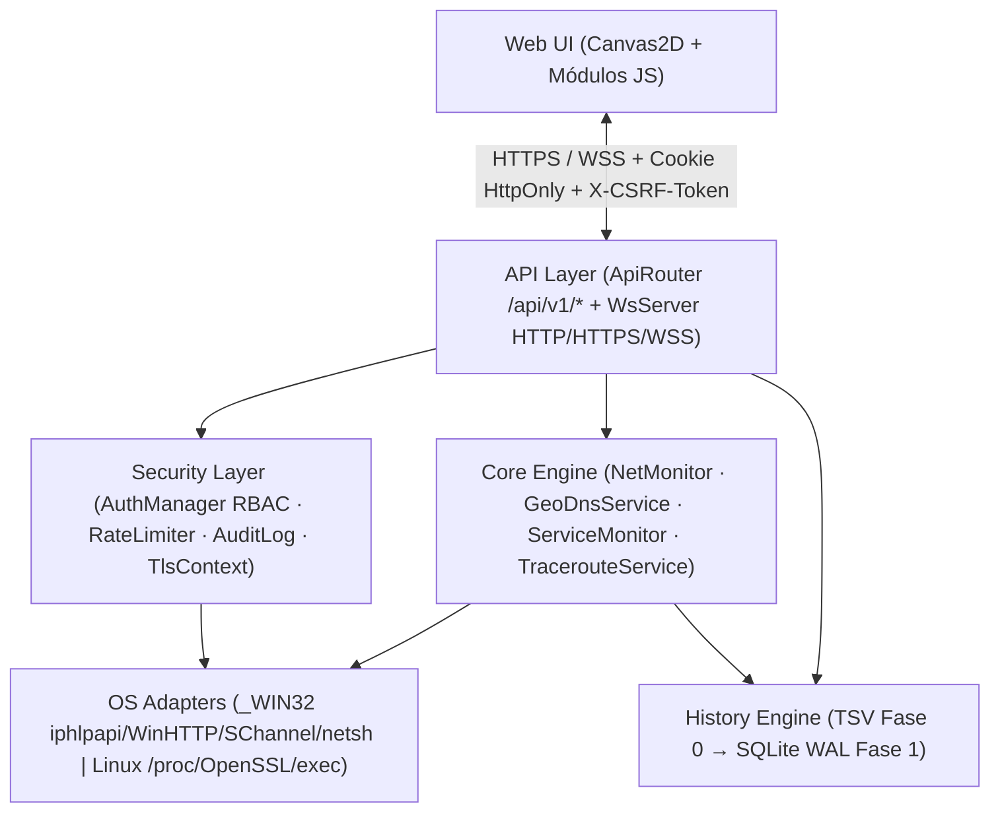

# NetPulse — Arquitetura da Plataforma

## 1. Visão Geral

O **NetPulse** é uma plataforma nativa de observabilidade, diagnóstico e segurança de redes construída sobre um motor **C++20 (`/O2`)** com servidor HTTP/HTTPS e WebSocket (RFC-6455) embutido e interface web modular em HTML5 Canvas2D (`static/`).

Todas as análises comportamentais e diagnósticos operam de forma **100% determinística** (regras, estatística descritiva, percentis e correlação de estado), sem inteligência artificial, LLMs ou dependência obrigatória de nuvem.

---

## 2. Diagrama de Arquitetura (Fase 0 → Alvo Modular)

---

## 3. Estrutura de Módulos (Estado Atual — Pós-Fase 0)

| Módulo / Diretório | Arquivos | Responsabilidade |
| :--- | :--- | :--- |
| **Core Utilities** | `src/core/json_lite.hpp`, `src/core/json_lite.cpp` | Parser RFC-8259 estrito com limite de profundidade (32) e tamanho (64 KB). |
| **Models & Serializer** | `src/models.hpp`, `src/serializer.hpp`, `src/version.hpp` | Estruturas de telemetria e serialização JSON para snapshots em tempo real. |
| **Network Collector** | `src/net_monitor.hpp`, `src/net_monitor.cpp` | Coleta de sockets TCP/UDP IPv4/IPv6, PID/executável, EStats/Process IO e NIC RX/TX. |
| **GeoIP & rDNS** | `src/geo_dns.hpp`, `src/geo_dns.cpp`, `src/mmdb_reader.*` | Leitor offline MaxMind DB (`.mmdb`), batch GeoIP cacheado e pool assíncrono de rDNS. |
| **Service & Trace** | `src/service_monitor.*`, `src/traceroute.*` | Probes TCP contínuos (âncoras regionais + customizados) e traceroute ICMP/exec. |
| **Security Engine** | `src/security/auth_manager.*`, `audit_log.*`, `rate_limiter.*`, `tls_context.*` | Tokens RBAC (`Viewer`, `Operator`, `Administrator`), sessões com expiração, CSRF, TLS (SChannel/OpenSSL), rate limit e auditoria operacional. |
| **API & Transport** | `src/api/api_router.*`, `src/ws_server.*` | Roteamento `/api/*` e `/api/v1/*`, validação de `Host`/`Origin`, headers de segurança, path traversal guard e WebSocket autenticado. |
| **Host Actions** | `src/actions.*`, `src/tray_host.*`, `src/updater.*` | Encerramento de processos protegidos, bloqueio/reversão de firewall, system tray Win32 e auto-updater SHA-256 fail-closed. |
| **Persistence (Fase 0)** | `src/history_store.*`, `src/settings_store.*` | Persistência TSV atual (`events_history.tsv`, `service_metrics.tsv`, `settings.tsv`, `auth_tokens.tsv`, `security_audit.tsv`, `blocked_ips.tsv`). |

---

## 4. Fluxo de Segurança por Requisição

1. **TLS Handshake** (quando `--tls` ou acesso remoto sem proxy TLS): SChannel (Windows) ou OpenSSL (Linux).
2. **Rate Limiter por IP**: janela deslizante na camada de transporte + bloqueio estrito em `/api/auth/login`.
3. **Host & Origin Validation**: proteção contra DNS Rebinding (`Host`) e CSRF/CSWSH (`Origin`).
4. **Autenticação & RBAC**: `Authorization: Bearer <token>` ou cookie `np_session` (`HttpOnly; SameSite=Strict`) + `X-CSRF-Token` obrigatório em mutações.
5. **Confirmação Explícita & Auditoria**: operações destrutivas exigem `"confirm": true` e gravam registro imutável em `security_audit.tsv`.
