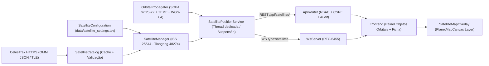

# NetPulse — Satellite Tracking V1: Auditoria & Arquitetura

## 1. Auditoria da Arquitetura Atual (NetPulse v2.0.0)

Antes da implementação do módulo **Satellite Tracking V1**, foi realizada auditoria completa do repositório `netpulse-map`:

1. **Motor Backend C++20 (`src/`)**:
   - Compilado nativamente com `/std:c++20 /O2` (MSVC no Windows via `build.bat`) e `-std=c++20 -O2` (GCC/CMake no Linux via `CMakeLists.txt` e `Dockerfile`).
   - Dependência única embarcada em `third_party/sqlite/` (SQLite 3.54.1 amalgamation) + bibliotecas nativas do SO (`WinHTTP`/`Winsock2`/`SChannel`/`BCrypt`/`iphlpapi` no Windows; `OpenSSL`/`POSIX sockets`/`/proc` no Linux).
   - `src/main.cpp` inicializa todos os serviços desacoplados (`AuthManager`, `AuditLog`, `RateLimiter`, `TlsContext`, `GeoDnsService`, `ServiceMonitor`, `SettingsStore`, `HistoryStore`, `TracerouteService`, `NetworkQualityEngine`, `InterfaceMonitor`, `DiscoveryEngine`, `IntelligenceEngine`, `NotificationEngine`, `UpdateManager`, `NetMonitor`) e executa `pollThread` em loop contínuo.

2. **Renderização do Mapa Geográfico (`static/topo.js`, `static/map-canvas.js`)**:
   - Canvas principal `#planetCanvas` (`PlanetMapCanvas`) renderizado em 60fps via `requestAnimationFrame`.
   - `static/topo.js` decodifica `assets/countries-110m.json` (TopoJSON offline, 177 países) e disponibiliza 3 projeções cartográficas em `PROJECTIONS`: `naturalEarth`, `equirectangular` e `mercator`, cada qual com `project(lon, lat) -> [nx, ny]` e `unproject(nx, ny)`.
   - `PlanetMapCanvas` mantém um buffer offscreen (`baseLayerCanvas`) e renderiza camadas em ordem: fundo espacial/estrelas → mapa base → varredura longitudinal → destaque de países → terminador solar Dia/Noite → camada `local` ou `global` → ripples → overlay de traceroute.
   - A extensão natural é compor uma camada independente `SatelliteMapOverlay` sobre o canvas, usando exatamente `mapCanvas.projectToScreen(lon, lat)` para respeitar a projeção ativa, pan e zoom.

3. **Comunicação Backend → Frontend**:
   - **WebSocket (`/ws`)**: `pollThread` serializa o snapshot de rede via `serializeSnapshotJson()` (`src/serializer.hpp`) e faz broadcast via `WsServer::broadcastText()`.
   - **HTTP REST (`/api/*` e `/api/v1/*`)**: `ApiRouter` (`src/api/api_router.cpp`) roteia endpoints REST sob demanda com normalização `/api/v1/` → `/api/`.
   - **Estratégia de Integração Desacoplada**: `SatellitePositionService` opera em thread própria, totalmente independente do `NetMonitor`, expondo endpoints REST `/api/satellites*` e enviando mensagens WebSocket tipadas `{"type":"satellites", ...}` apenas quando a camada estiver ativa e houver clientes conectados. No `static/app.js`, mensagens com `data.type === 'satellites'` são roteadas diretamente para o estado orbital sem interferir em `state.snapshot`.

4. **Servidor HTTP e WebSocket (`src/ws_server.*`, `src/api/api_router.*`)**:
   - `WsServer` implementa HTTP/1.1 e WebSocket RFC-6455 (com suporte a TLS via SChannel/OpenSSL), validação estrita de `Host` e `Origin`, rate limiting por IP e proteção contra path traversal.
   - `ApiRouter` exige autenticação via cookie `np_session` (`HttpOnly; SameSite=Strict`) ou `Authorization: Bearer`, RBAC (`Viewer`, `Operator`, `Administrator`), token `X-CSRF-Token` em mutações e registro em `AuditLog`.

5. **Configuração e Persistência**:
   - Configurações de usuário seguem o padrão TSV (`chave\tvalor`) em `data/` (`SettingsStore` em `data/settings.tsv`, `ServiceMonitor` em `data/custom_services.tsv`).
   - Cache de longa duração e dados analíticos ficam em `data/geoip_cache.tsv` ou SQLite WAL (`data/netpulse.db`).
   - Para manter independência total do banco de conexões, `SatelliteConfiguration` persiste preferências em `data/satellite_settings.tsv` e `SatelliteCatalog` persiste elementos orbitais em `data/satellite_catalog_cache.json`.

6. **Mecanismos Existentes de Atualização, HTTPS e Cache**:
   - `GeoDnsService` demonstra o padrão de cache em disco + thread assíncrona com `std::condition_variable_any`.
   - `NotificationEngine` (`src/notifications/notification_engine.cpp`) demonstra cliente HTTPS nativo multiplataforma (`WinHTTP` com `WINHTTP_FLAG_SECURE` no Windows; `POSIX socket + OpenSSL` com SNI e `SSL_VERIFY_PEER` no Linux). Esse padrão é adotado no `SatelliteCatalog` para comunicação segura com o CelesTrak via HTTPS.

---

## 2. Arquitetura Proposta do Módulo (Satellite Tracking V1)

### Componentes e Responsabilidades

| Componente | Arquivo(s) | Responsabilidade |
| :--- | :--- | :--- |
| **SatelliteModels** | `src/satellite/satellite_models.hpp` | Estruturas de domínio: `OrbitalElements`, `SatellitePosition`, `TrackPoint`, `SatelliteTrack`, `SatelliteInfo`, `SatelliteTrackingConfig`. |
| **SatelliteConfiguration** | `src/satellite/satellite_configuration.*` | Leitura/gravação atômica em `data/satellite_settings.tsv`, ativação da camada, seleção individual, exibição/extensão de trajetória e intervalos. |
| **SatelliteCatalog** | `src/satellite/satellite_catalog.*` | Download HTTPS (CelesTrak OMM JSON / TLE), parsing estrito, checksum Mod-10 TLE, validação de integridade, cache em disco (`data/satellite_catalog_cache.json`) e preservação do último conjunto válido em falhas. |
| **OrbitalPropagator** | `src/satellite/orbital_propagator.*` | Implementação C++20 determinística do modelo **SGP4** (Vallado AIAA-2006-6753, constantes WGS-72) + conversão TEME → PEF/ECEF → Geodésica WGS-84 + segmentação de trajetória no antimeridiano. |
| **SatelliteManager** | `src/satellite/satellite_manager.*` | Catálogo de objetos monitorados V1 (ISS `25544` e Tiangong `48274`), coordenação entre configuração/catálogo/propagador e agendamento periódico de atualização orbital. |
| **SatellitePositionService** | `src/satellite/satellite_position_service.*` | Thread dedicada com frequência configurável, suspensão automática (0% CPU) quando desativado ou sem objetos ativos, geração de snapshots JSON e notificação WebSocket. |
| **SatelliteMapOverlay** | `static/satellite-overlay.js` | Camada independente no `PlanetMapCanvas` para desenhar trajetória percorrida, projeção futura, marcadores distintos, rótulos e hit-testing. |

---

## 3. Convenções de Tempo, Referência e Geoprocessamento

### 3.1 Escalas de Tempo (UTC e Julian Date)
- As épocas dos elementos OMM (`EPOCH` ISO-8601 UTC) e TLE (`YYDDD.DDDDDDDD` UTC) são convertidas para **Julian Date UTC** dividida em parte inteira/meio-dia (`jdsatepoch`) e fração do dia (`jdsatepochF`) para preservar precisão sub-milissegundo em `double` IEEE-754.
- O parâmetro `tsince` passado ao propagador SGP4 é calculado em **minutos desde a época**:
  $$\Delta t = \left[(JD_{\text{UTC}} - JD_{\text{epoch}}) + (JD_{\text{UTC,frac}} - JD_{\text{epoch,frac}})\right] \times 1440.0$$
- Para a rotação terrestre (GMST), utiliza-se `JD_UTC` como aproximação padrão de `JD_UT1` ($|DUT1| < 0.9\text{ s}$, impacto máximo $\approx 0.4\text{ km}$ em solo, adequado e padrão para rastreamento orbital SGP4 V1).

### 3.2 Sistema de Referência SGP4 (TEME) e Constantes
- O propagador SGP4 segue **Vallado (AIAA 2006-6753 / Spacetrack Report #3)** utilizando constantes **WGS-72** (obrigatórias para compatibilidade com TLE/OMM GP publicados pelo NORAD/CelesTrak):
  - $\mu = 398600.8\text{ km}^3/\text{s}^2$
  - $R_{\oplus} = 6378.135\text{ km}$
  - $J_2 = 0.001082616$, $J_3 = -0.00000253881$, $J_4 = -0.00000165597$
- As saídas do SGP4 são vetores posição $\mathbf{r}_{\text{TEME}}$ (km) e velocidade $\mathbf{v}_{\text{TEME}}$ (km/s) no referencial **TEME (True Equator, Mean Equinox)**.

### 3.3 Conversão TEME → ECEF/PEF → Geodésica (WGS-84)
1. Calcula-se o **Greenwich Mean Sidereal Time ($\theta_{\text{GMST}}$)** pela fórmula IAU-1982:
   $$T = \frac{JD - 2451545.0}{36525.0}$$
   $$\theta_{\text{GMST}}(\text{s}) = 67310.54841 + (876600\cdot 3600 + 8640184.812866)T + 0.093104 T^2 - 6.2\times 10^{-6} T^3$$
2. Rotaciona-se $\mathbf{r}_{\text{TEME}}$ em torno do eixo Z por $+\theta_{\text{GMST}}$ para obter coordenadas fixas à Terra (PEF/ECEF aproximado):
   $$x_E = x_T \cos\theta + y_T \sin\theta, \quad y_E = -x_T \sin\theta + y_T \cos\theta, \quad z_E = z_T$$
3. Converte-se $(x_E, y_E, z_E)$ para latitude geodésica $\phi$, longitude $\lambda$ e altitude $h$ sobre o elipsoide **WGS-84** ($a = 6378.137\text{ km}$, $f = 1 / 298.257223563$) via iteração de Bowring com tolerância $10^{-11}\text{ rad}$:
   - $\lambda = \operatorname{atan2}(y_E, x_E) \in [-180^\circ, +180^\circ]$
   - $\phi \in [-90^\circ, +90^\circ]$
   - $h = \frac{p}{\cos\phi} - N(\phi)$ (ou $|z_E|/\sin\phi - N(\phi)(1-e^2)$ próximo aos polos)

### 3.4 Tratamento do Antimeridiano ($\pm 180^\circ$)
- Ao gerar trajetórias orbitais (passada e futura), verifica-se a transição entre pontos consecutivos $(\lambda_i, \phi_i)$ e $(\lambda_{i+1}, \phi_{i+1})$.
- Sempre que $|\lambda_{i+1} - \lambda_i| > 180^\circ$, a trajetória cruza o antimeridiano. O ponto exato de cruzamento $(\pm 180^\circ, \phi_{\text{cross}})$ é interpolado no espaço desenrolado ($\lambda \pm 360^\circ$), encerrando o segmento atual na borda do globo e iniciando um novo segmento na borda oposta. Isso elimina linhas cruzando horizontalmente o mapa em todas as projeções (`Natural Earth`, `Equirectangular`, `Mercator`).

---

## 4. APIs REST & WebSocket Propostas

- `GET /api/satellites` (`/api/v1/satellites`) — (`Viewer+`) Retorna configuração, status do catálogo e posições + trajetórias atuais dos objetos ativos.
- `GET /api/satellites/catalog` (`/api/v1/satellites/catalog`) — (`Viewer+`) Retorna metadados dos elementos orbitais em cache e estado de atualização.
- `POST /api/satellites/config` (`/api/v1/satellites/config`) — (`Operator+` + CSRF + AuditLog) Atualiza ativação do módulo, satélites visíveis, exibição/horizonte de trajetória e frequência de atualização.
- `POST /api/satellites/refresh` (`/api/v1/satellites/refresh`) — (`Operator+` + CSRF + AuditLog) Dispara atualização manual dos elementos orbitais respeitando proteção anti-abuso.
- **WebSocket `/ws`**: Envia frames JSON `{"type":"satellites", ...}` na cadência configurada apenas enquanto a camada estiver ativa e houver objetos selecionados.
